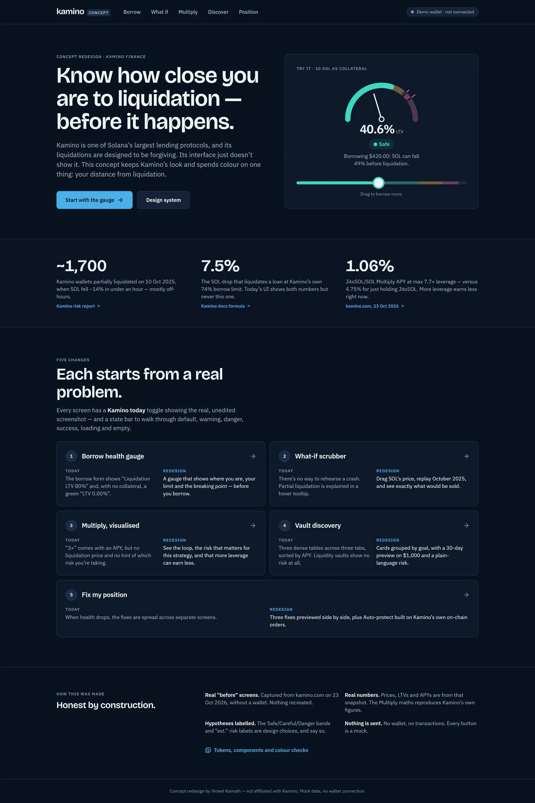
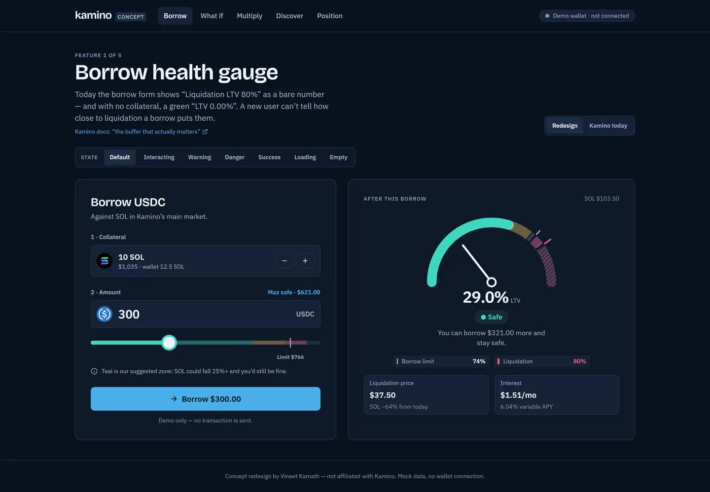
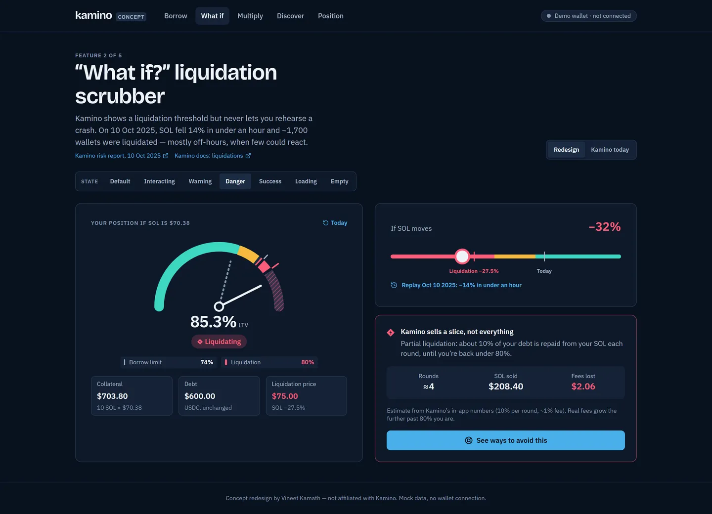
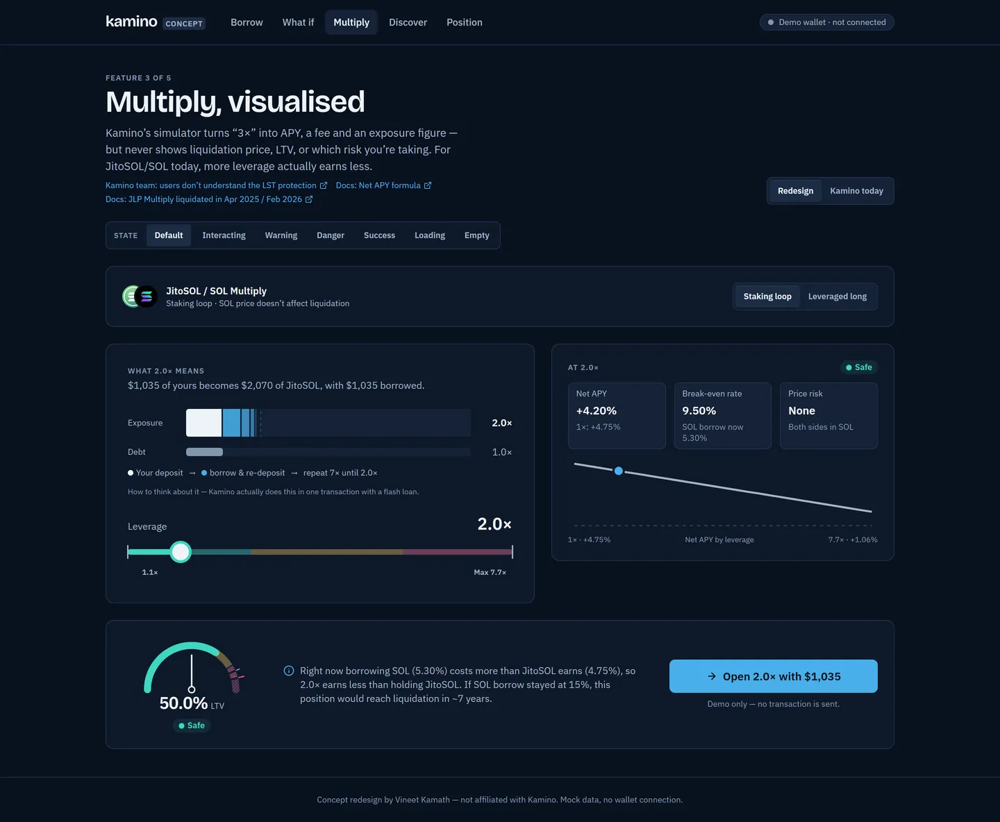
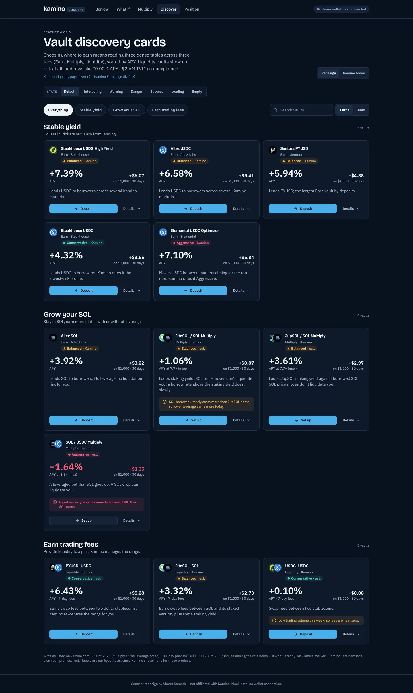
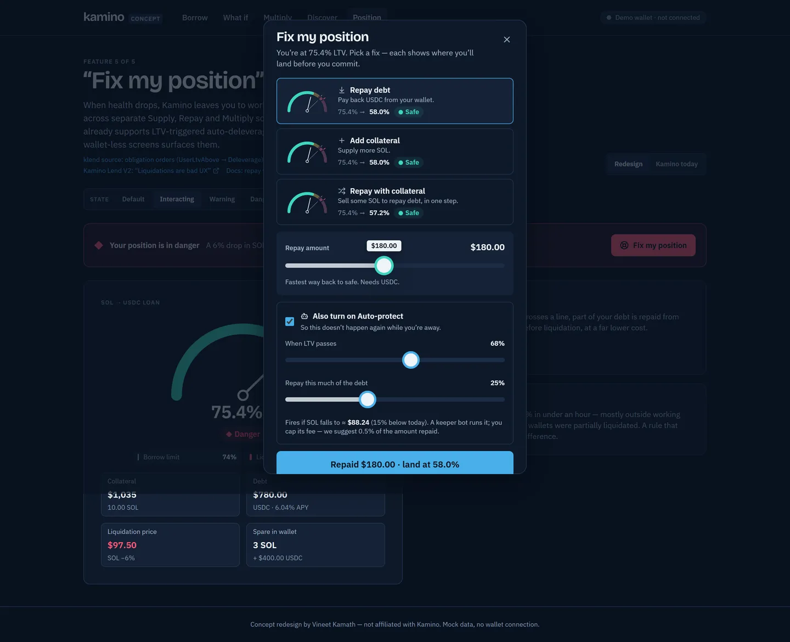
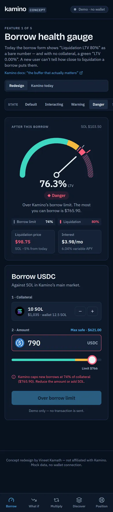

# Kamino, redesigned

**Know how close you are to liquidation — before it happens.**
A concept redesign of [Kamino Finance](https://kamino.com) for Superteam India's *Redesign Your Favourite App on Solana* bounty.

> **Concept redesign by Vineet Kamath — not affiliated with Kamino. Mock data, no wallet connection.**

| | |
|---|---|
| **Live prototype** | _Vercel URL — added after deploy_ |
| **Figma** | https://www.figma.com/design/GHO9koxTsxN8yE7zzaVxOO |
| **Write-up** | [writeup.md](writeup.md) (~1 page) |
| **Design system** | [DESIGN-SYSTEM.md](DESIGN-SYSTEM.md) · live at `/system` |
| **Research** | [audit](docs/research/audit.md) · [mechanics](docs/research/mechanics.md) · [evidence](docs/research/pain-points.md) · [feature specs](docs/research/feature-specs.md) |
| **QA · video** | [QA checklist](docs/QA-CHECKLIST.md) · [walkthrough shot list](docs/VIDEO-SHOTLIST.md) |



## The idea
Kamino's risk engine is forgiving — partial liquidations, stake-rate pricing for LSTs, on-chain LTV orders — but the interface doesn't show it: risk is three bare percentages, and green means both "earning" and "safe". This concept keeps Kamino's navy, sky-blue and IBM Plex Sans, and spends colour on one thing: **distance from liquidation**, always paired with a shape and a word (● Safe ▲ Careful ◆ Danger).

## Five features
| # | Feature | Route |
|---|---|---|
| 1 | **Borrow health gauge** — one gauge for you, Kamino's limit and liquidation; "You can borrow $X more and stay safe." | `/borrow` |
| 2 | **"What if?" scrubber** — drag SOL's price, replay the 10 Oct 2025 crash, see partial liquidation explained | `/what-if` |
| 3 | **Multiply, visualised** — the loop, the risk that applies to *this* strategy, and why more leverage earns less today | `/multiply` |
| 4 | **Vault discovery cards** — grouped by goal, 30-day preview on $1,000, plain-language risk; table toggle for pros | `/discover` |
| 5 | **"Fix my position"** — three fixes previewed side by side + Auto-protect (maps to Kamino's on-chain obligation orders) | `/position` |

Every feature page has a **"Kamino today" toggle** showing the real, unedited screenshot, and a **state bar** — every state is a URL: `?state=default|interacting|warning|danger|success|loading|empty`.

| Borrow | What if (danger) | Multiply |
|---|---|---|
|  |  |  |
| **Discover** | **Fix my position** | **Mobile** |
|  |  |  |

## Honest by construction
- **Before = real.** 27 screenshots of kamino.com captured 23 Oct 2026 in a clean browser with no wallet. Nothing recreated. Feature 5's "before" needs a connected wallet and is shown as a labelled gap, not a mock-up.
- **Real numbers.** Prices, LTVs and APYs come from that snapshot (`src/data/kamino.ts`, sources inline). The Multiply maths matches Kamino's displayed 1.06% APY at 7.7×.
- **Hypotheses labelled.** The Safe/Careful/Danger bands (≥25% / 10–25% / <10% price buffer) and "est." vault risk labels are design choices and say so.
- **Nothing is sent.** No wallet, no transactions.

## Quality
- WCAG 2.1 AA: **0 axe violations** across every route × state × size; all colour pairs ≥ 4.5:1, risk hues distinct under simulated protanopia/deuteranopia/tritanopia (`tools/check-colors.mjs`).
- Keyboard: sliders (arrows, PgUp/PgDn, Home/End), focus-trapped sheet, Esc + focus return (`tools/keyboard.mjs`).
- `prefers-reduced-motion` respected; responsive 390 → 1440.

## Run it
```bash
npm install
npm run dev        # http://localhost:5173
npm run build      # production build
```
Stack: Vite · React 18 · TypeScript · Tailwind · Framer Motion · Lucide. Token logos from Kamino's own CDN (`public/tokens/SOURCES.md`).

---
Concept redesign by Vineet Kamath — not affiliated with Kamino. Mock data, no wallet connection.
